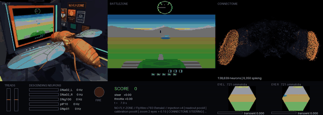

# NO-FLY-ZONE

A real fruit-fly connectome fighting for its life in a tank it was never
licensed to drive.



*Left: the fly seated at the CRT, with the one she is fighting for pinned to
the wall. Middle: Atari Battlezone. Right: 138,639 neurons, spikes glowing.
Bottom: the descending neurons it is read out from. Everything on the footer
is a named, measured mapping.*

The complete Drosophila brain wiring diagram (FlyWire v783 today, 138,639
neurons; MaleCNS planned) runs as a spiking simulation and is seated as the **pilot** inside a
retro-futuristic 3D cockpit. The cockpit's screen shows Atari **Battlezone**;
the fly's compound eyes watch that screen; its descending motor neurons work
the cockpit controls; the controls drive the game. Fly → cockpit → tank →
robot war.

## Status

Last audited 2026-09-14 against the code, not the commit messages.

The wired pipeline is complete end to end: game → CRT texture → eye renders →
hex retina → brain → descending-neuron rates → levers → ALE action. Two brains
satisfy the same contract: the hand-written reflex stub and a sparse
NumPy/SciPy port of the Shiu et al. 2024 whole-brain LIF model over FlyWire
v783. `scripts/run_m3.py` drives Battlezone from real descending neurons with a
spike-cloud dashboard panel. Developed on the Apple-silicon Mac; on
2026-09-14 the full script ladder was run on the Ubuntu workstation and every
gate passed with the same brain numbers. The same day the brain gained a CUDA
backend (`brain_cuda.py`: Triton kernels, one CUDA graph per game tick) that
matches the SciPy reference step for step and runs the whole-brain pilot at
about 5x faster than real time on the RTX 4090, versus 8x slower on the CPU.
`--backend cpu|cuda|auto` selects it in `run_m3.py` and `validate_brain.py`;
`scripts/compare_backends.py` is the equivalence gate.

Later the same day the pilot was made to play: named injection maps, a
retina zoom and per-eye windows, descending-neuron readout pools chosen by a
screen, saccadic gating and a startle refractory, lateralisation-index
steering, and rewired/silenced wiring controls. Along the way the reference
model turned out to have a self-sustaining olfactory state (dopamine signed
as fast excitation) that a loader option removes with the validation gates
intact. The fly now fires at tanks that come into view, backs off from loom,
turns toward off-axis targets, and scores about one kill per 30 s episode;
so does a degree-preserving random rewiring of the same brain. Details and
the honest benchmark: `docs/research/cascade-probe-2026-09-14.md`.

| Milestone | State | Note |
|---|---|---|
| M0 scaffold, smoke scripts | done | The smoke "tests" are scripts, not pytest; there is no `tests/` directory. |
| M1 game frame → CRT texture → eye camera | done | The orientation gate guards vertical flips only. |
| M2 closed loop with the reflex stub | done | Levers are a kinematic puppet derived from the action, not causal. |
| M2.5 flybody seated in the cockpit | done | Kinematic attach; eye cameras are world-fixed at head height; silent fallback to the bare cockpit. |
| M3 whole-brain LIF core, validated | done | Gates are qualitative (MN9 > 5 Hz, any giant-fibre spike), single seed. CPU (SciPy) and CUDA (Triton) backends agree. |
| M4 connectome pilots in wired mode, dashboard | partial | Idle scan now off by default and labelled when on; pooled readouts, saccadic gating and LI steering give event-driven play with real turns and kills; but the same-seed benchmark cannot yet separate the measured wiring from a rewired control; no eyes panel; mp4 compositor rather than a live view. |
| M5 cockpit art pass | partial | Neon, lighting, set dressing and decals done; the screen is a flat box showing the raw frame; the single damage lamp sits about 35° above the eye cameras' axis, so the retina never sees it. |
| M6 embodied mode, contact-driven controls | not started | No `mj_step`, actuators or contact reads; no `--pilot` flag exists. |
| M7 learning and showcase video | not started | Only the `signals` hook is plumbed; both brains ignore it. |

Doc-versus-code gaps are listed in `docs/architecture.md` under "Status audit".
The important ones: only FlyWire v783 is loaded, and pIP10 does not exist in
the female brain, so oviDN is read out under that name.

## Next Steps

1. Done 2026-09-14: the whole ladder passes on the workstation with the
   versions recorded under Machines. Still open: pin `mujoco`, `ale-py` and
   `gymnasium` in `pyproject.toml` once the Mac confirms the same versions.
2. Done 2026-09-14: the CUDA brain backend. Still open there: a live viewer
   that uses the headroom, and a `tests/` directory wrapping
   `compare_backends.py` and the smoke gates under pytest.
3. Done 2026-09-14 in spirit: cascade probes, DN audit and screen, `--ablate`
   controls, idle scan off, pooled readouts, `bench_pilots.py`
   (`docs/research/cascade-probe-2026-09-14.md`). Still open: DN calibration
   from measured closed-loop distributions (the `pool4` spans are
   provisional), a `tests/` directory, and a provenance hash on every
   artefact.
4. Show that the wiring matters, or find out that it does not: longer
   episodes with off-axis targets, a balanced-success metric over left and
   right targets, a gain-matched rewired control, and more seeds. Then a live
   viewer with an eyes panel, and the eye-render settings fix.
5. MaleCNS v1.0 loader, which also gives a real pIP10 and the VNC for M6.
6. Then M6 and M7, which are fresh work; any dopamine rule needs an LR=0
   control and a shuffled-pathway control pre-registered before the first run.

## Architecture

```
[ALE BattleZone-v5] ←— joystick actions —— [cockpit control state]
        |                                          ↑
    RGB frames                            control physics (MuJoCo)
        ↓                                          ↑
[MuJoCo cockpit: CRT screen geom ← frame texture upload]
        ↓  eye cameras (offscreen render)
[retina: hex ommatidia binning → photoreceptor drive]
        ↓
[LIF spiking brain over the real connectome (Shiu et al. 2024 params)]
        ↓  descending neurons (DNa02 steer, pIP10 fire, DNp01 startle, ...)
[motor mapping → levers / pedals / trigger]
```

Two pilot modes, same brain and eyes:
- **wired** — descending-neuron rates drive animated cockpit controls directly
  (the working baseline)
- **embodied** — the TuragaLab `flybody` model physically seated in the
  cockpit, motor neurons → leg actuators → contact forces on the levers
  (the over-the-top goal)

## Quickstart (any machine)

```bash
git clone https://github.com/JackDanHollister/no-fly-zone
cd no-fly-zone
python3 -m venv .venv                 # python >= 3.11
.venv/bin/pip install -e .            # ale-py bundles the Atari ROMs legally
.venv/bin/python scripts/fetch_assets.py   # fly body + connectome data, ~570 MB
.venv/bin/python scripts/smoke_battlezone.py
.venv/bin/python scripts/smoke_cockpit_screen.py
.venv/bin/python scripts/run_m2.py --video          # reflex-stub pilot, fast
.venv/bin/python scripts/validate_brain.py          # LIF core vs published results
.venv/bin/python scripts/run_m3.py --steps 150 --video  # the real connectome plays
```

Videos and renders land in `out/`. macOS-only gotcha: if `import noflyzone`
fails after installing, see the `.pth` note in `docs/architecture.md`.

## Machines

- **Dev**: Apple-silicon Mac — everything runs here (MuJoCo has native arm64
  wheels; ALE bundles the Atari ROMs legally; the brain sim is sparse
  NumPy/SciPy on the CPU, so `run_m3.py` runs in slow motion).
- **Final**: workstation (Ubuntu 26.04, RTX 4090, 192 GB RAM) — lives in The
  Magi Home Edition workspace as `projects/no-fly-zone/`; set up and validated
  2026-09-14 with Python 3.12.14, mujoco 3.13.0, ale-py 0.12.1, gymnasium
  1.3.0, numpy 2.5.3, scipy 1.18.1, pandas 3.0.5, pyarrow 25.0.1, pillow
  12.3.0, imageio 2.37.4, plus torch 2.14.0+cu130 with triton 3.8.0 for the
  CUDA brain backend (`pip install -e ".[cuda]"`). All components are pure
  Python; only backends swap.

Linux workstation setup, with the CUDA backend:

```bash
python3.12 -m venv .venv            # any Python 3.11-3.13 with pip; uv works too
.venv/bin/pip install -e ".[cuda]"  # torch with bundled CUDA; Triton comes with it
export MUJOCO_GL=egl                # for every script that renders when not on a desktop terminal
.venv/bin/python scripts/smoke_battlezone.py
```

`imageio[ffmpeg]` bundles its own ffmpeg, so `--video` works without apt
ffmpeg. `fetch_assets.py` needs git 2.25 or newer and github.com access.

Measured on the workstation, 2026-09-14, all under `MUJOCO_GL=egl`:

| Script | Result |
|---|---|
| `smoke_battlezone.py` | 500 random steps in 0.3 s |
| `smoke_cockpit_screen.py` | PASS bare and with the fly; CRT whites reach 255 in the eye renders, so `WHITE_REF` stands |
| `run_m2.py --video` | PASS, 600 steps, about 233 Hz with the fly attached (Mac: about 21 Hz) |
| `validate_brain.py` | PASS, load 1 s, MN9 101 Hz, giant fibre 66/64 Hz, 1 s sim per 5 s wall (identical to the Mac) |
| `run_m3.py --steps 90 --video` (cpu) | PASS, 7.7x slower than real time; brain 492 ms of the 499 ms tick |
| `run_m3.py --backend cuda --steps 450` | PASS, 30 s of game in 5.8 s wall (5.2x real time); brain 8.9 ms, loop about 80 Hz |
| `validate_brain.py --backend cuda` | PASS, MN9 102 Hz, giant fibre 66/64 Hz; 1 s sim in 0.2 s wall |
| `compare_backends.py` | PASS: per-step spike sets identical for 500 steps; 0.3 s aggregates within 1%; tick 5.5 ms on CUDA vs 263 ms on CPU |

MuJoCo 3.13 prints an attach-conflict warning when seating the fly: the
flybody's option block (0.1 ms timestep, gravity -981 in centimetre units)
differs from the cockpit's and the parent values are kept. Harmless for the
kinematic puppet, but the unit and timestep mismatch must be resolved before
embodied mode.

macOS note: keep the step→upload-texture→render loop single-threaded (GL must
stay on the main thread).

## Layout

- `src/noflyzone/` — package (game bridge, cockpit scene, retina, brain;
  `brain_lif.py` is the SciPy reference, `brain_cuda.py` the Triton/CUDA
  backend, `brain_backend.py` picks one)
- `scripts/` — runnable smoke tests and demos
- `docs/architecture.md` — full design notes, milestone checklist and status audit
- `CHANGELOG.md` — dated session log
- `assets/` — flybody model (gitignored, fetched by `scripts/fetch_assets.py`)
- `data/` — connectome downloads (gitignored, same script)
- `out/` — renders and videos (gitignored)

## Data & reference implementations

- MaleCNS v1.0 (Janelia/Google, CC-BY): https://male-cns.janelia.org — planned,
  no loader yet
- FlyWire v783 dump (CC-BY, no login): https://zenodo.org/records/10676866 —
  the code loads v783 from the Shiu model repository instead of this dump
- LIF parameters: Shiu et al., Nature 634:210 (2024) — github.com/philshiu/Drosophila_brain_model
- Eye sampling: flygym Retina (NeLy-EPFL), aimbug (slickdomi/aimbug, MIT),
  DOOMFLY (nftechie/doomfly, MIT)
- Body model: TuragaLab/flybody (MuJoCo)

## Licence and data

Code: MIT (see `LICENSE`). The data this fetches is not in the repository and
carries its own terms: the Shiu et al. brain model and connectivity are MIT;
FlyWire v783 is CC-BY-NC 4.0; the flywire annotations are from the Jefferis
lab; the flybody model is Apache-2.0 from MuJoCo Menagerie; the Atari ROM
ships legally inside `ale-py`.

## How this was built

Designed and steered by Jack Hollister, with Claude Code as the pair
programmer for the code, the probes and the write-ups. Every number in this
README and in `docs/` was measured on the machine that ran it, and every
claim about the fly's behaviour is checked against rewired and silenced
controls before it is made. Where the answer is "not yet shown", it says so.
