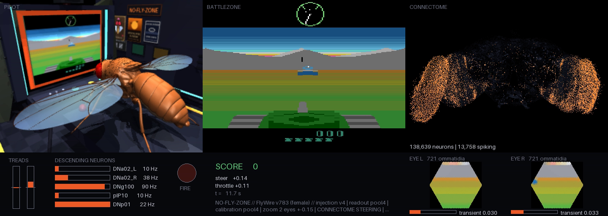

# NO-FLY-ZONE

**A fruit-fly brain. A tank cockpit. An extremely questionable driving licence.**


*Closed-loop recording, seed 0, played at game speed. FlyWire v783 female
connectome, with the model corrections described below. The dashboard shows
the cockpit, the game, spiking activity, motor readouts and what each eye samples.*

I put a simulated fruit-fly brain in a MuJoCo cockpit and connected it to
Atari Battlezone. It watches the game on a screen inside that cockpit,
turns toward targets, fires, and backs away from expanding objects. In the
physical-control version, its forelegs push the levers and its proboscis
presses the fire button.

The default pilot runs **138,639 neurons and about 15.1 million directed
connections** from FlyWire v783 through a whole-brain spiking model. A custom
Triton/CUDA backend runs the wired loop at about **five times real time on
an RTX 4090**. The physical cockpit runs at about real time.

**[Read the build story →](JOURNEY.md)** ·
[How it works](docs/architecture.md) ·
[Experiments and results](#what-the-experiments-show) ·
[Run it](#run-it) ·
[Session history](CHANGELOG.md)

> Review draft, 22 September 2026. The build and experiments below are real;
> the public-facing write-up is awaiting the author's review.

## What I built

- **A complete visual feedback loop.** Battlezone becomes a CRT texture;
  the fly's eye cameras see that texture; two 721-sample hexagonal retinas
  drive the brain; descending-neuron activity drives the tank.
- **A whole-brain GPU engine.** Sparse SciPy reference, Triton kernels,
  CUDA graphs and batched flies, with CPU/GPU comparison gates.
- **A cockpit worth sitting in.** Neon, armour, rivets, posters, ammunition,
  a kill tally and a framed sweetheart portrait saying “COME HOME SAFE”.
- **Contact-driven controls.** A tethered flybody model moves actual simulated
  levers and a sprung fire button. Their measured positions choose the action.
- **An experimental workbench.** Synthetic visual probes, whole-brain and
  within-hemisphere shuffles, gain controls, two connectomes, trained policy
  readouts and plasticity experiments with frozen evaluations.
- **A way to watch and inspect it.** Live dashboard, eye mosaics, spike-cloud
  panel, labelled recordings and provenance metadata on new run artefacts.



The fly body, connectome and original neuron model come from the research
projects credited below. My contribution is the simulation pipeline, GPU
port, cockpit, sensory and control interfaces, probes and experiments.

## What the experiments show

The pilot plays. The more interesting question is which parts of that
behaviour depend on the measured wiring.

| Question | Result so far | Evidence |
|---|---|---|
| Does the measured wiring preserve target side? | Correct steering sign on 62 of 63 gated look ticks across ten 100-second episodes; five whole-brain shuffles managed 66 of 165. These are selected steering events, not accuracy over every frame. | [Wiring controls](docs/research/wiring-controls-2026-09-18.md) |
| Is keeping left and right apart enough? | A within-hemisphere shuffle also preserves side. The measured circuit nevertheless routes vision more selectively: 58 responsive descending types versus roughly 355, and 14 expansion-selective types versus at most two in the tested controls. | [Selectivity screen](docs/research/wiring-controls-2026-09-18.md#beyond-laterality-what-the-within-hemisphere-shuffle-cannot-inherit) |
| Can it carry motion and small-object signals? | With explicitly engineered input channels, the measured wiring produces downstream selectivity absent from the tested shuffles. Direction is supplied at T4/T5; the small-object channel is supplied at T2/T2a/T3. | [Motion](docs/research/wiring-controls-2026-09-18.md#with-direction-supplied-at-t4t5-the-wiring-builds-the-horizontal-and-vertical-systems), [size tuning](docs/research/size-tuning-2026-09-20.md) |
| Does it work in another fly? | MaleCNS v1.0 loads 166,700 neurons through the same engine. Several circuit results replicate after gain matching and correcting its retinal placement. | [Male retinotopy](docs/research/male-retinotopy-2026-09-20.md) |
| Does the wiring score more kills? | No demonstrated advantage over the whole-brain shuffled controls. In the September 18 benchmark: 2.7 kills per 100 seconds versus 2.3–2.7 for five shuffles. | [Game benchmark](docs/research/wiring-controls-2026-09-18.md#in-game-benchmark) |
| Does learning improve it? | Policy readouts learn survival, without a demonstrated kill advantage. Synaptic learning initially harms the pilot; correcting the timing yields two better and two worse learned brains, with no reliable overall improvement. | [Learning experiments](docs/research/learning-2026-09-19.md) |

The last experiment swapped one escape-related pathway between a better
and a worse learned brain. Each retained its survival pattern on both
recorded evaluation batches. That pathway alone does not explain the split.
[Results recovered from the completed September 20 runs](docs/research/learning-2026-09-19.md#the-pathway-swap-the-survival-pattern-stays-with-the-recipient-brain).

**A correction found while preparing this draft:** the learning evaluator
does not apply the independent-start procedure used by the pilot benchmark.
Its different seed labels do not establish different game starts; the
historical “unseen games” wording is too strong. The recorded learning
results remain in the journal, with this qualification. Generalisation
needs a corrected protocol and fresh runs.
[Evaluation audit and evidence](docs/research/learning-2026-09-19.md#evaluation-protocol-audit-2026-09-22).

## The boundary between biology and engineering

The **wiring and anatomical connection counts** come from measured
connectomes. The electrical activity is simulated with a simplified leaky
integrate-and-fire model derived from Shiu et al. Connection weights use
anatomical counts and transmitter signs; they are not measurements of each
synapse's physiological strength. The 15.1 million figure counts directed
connection records, rather than individual anatomical synapses.

The visual injection maps, neuron pools, rate calibration, steering rules,
movement gating and game reward signals are engineered. The standard playing
configuration removes fast aminergic weights and recurrent input to primary
sensory neurons; the uncorrected reference remains available. The synthetic
motion and small-object channels are separate experimental configurations.

In embodied mode, inverse kinematics and position servos turn descending
activity into leg movement. The fly's ventral nerve cord does not control
those servos. In wired mode, the levers are animated directly.

The experiments do not establish consciousness, an uploaded individual,
a general game-playing intelligence, or reliable learning to play better.
The distinctions between the reflex pilot, trained readout and learned
weights are shown on the recordings.

**No token, no coin, ever.**

## Run it

Python 3.12 is the tested workstation version; the package requires 3.11+.
Linux/NVIDIA provides the CUDA backend. The SciPy CPU backend also runs on
macOS, substantially slower. The pinned environment is in
[constraints.txt](constraints.txt).

```bash
git clone https://github.com/JackDanHollister/no-fly-zone.git
cd no-fly-zone
python3.12 -m venv .venv
.venv/bin/python -m pip install -e ".[dev]" -c constraints.txt
.venv/bin/python -m pytest -m "not data and not cuda"
.venv/bin/python scripts/fetch_assets.py
```

The initial fetch downloads roughly 570 MB of flybody, FlyWire and annotation
assets. They stay outside Git. MaleCNS is an additional, separate download.
On a headless Linux workstation, set `MUJOCO_GL=egl` before rendering:

```bash
export MUJOCO_GL=egl
.venv/bin/python scripts/smoke_battlezone.py
.venv/bin/python scripts/smoke_cockpit_screen.py
.venv/bin/python scripts/run_m2.py --video
```

That last command uses the hand-written reflex stub to check the pipeline.
For the whole-brain playing configuration:

```bash
# Linux/NVIDIA: install the GPU extras; omit this for the CPU backend.
.venv/bin/python -m pip install -e ".[cuda]" -c constraints.txt

.venv/bin/python scripts/run_m3.py --backend auto --steps 1500 --video \
  --injection v4 --readout pool4 --zoom 2 --eye-offset 0.15 \
  --saccade-hold 3 --startle-refractory 15 --steer-mode li \
  --aminergic zero --sensory external_only --trace my_run
```

Use `--backend cpu` to explicitly select SciPy, `--live` for a desktop window
(requires tkinter and a display), or `--pilot embodied` for physical controls.
The full set of flags matters: the script's bare defaults retain the early
reference configuration. Video is saved at game speed even when computation
is slower or faster than real time; inspect the reported wall-clock timing.

Validate the model and physical controls with:

```bash
.venv/bin/python scripts/validate_brain.py --backend auto
.venv/bin/python scripts/validate_embodied.py
.venv/bin/python -m pytest
# With a CUDA device and fetched data:
.venv/bin/python scripts/compare_backends.py
```

Tests needing connectome data, CUDA or the flybody skip when those resources
are absent. See [architecture and reproduction notes](docs/architecture.md)
for the male loader, benchmarks, hardware measurements and known limitations.

## Watch and read

The GIF and dashboard still above are included in the repo. The
[build story](JOURNEY.md) follows the project from the first screen render
through GPU acceleration, the first kills, controls, a second fly, physical
levers and the learning experiments.

The local `out/` directory also contains a 66-second showcase
(`no-fly-zone-showcase.mp4`), highlights, female/male and measured/shuffled
comparisons, and learned-brain recordings. Full videos and raw runs are
local review material; they are not hosted by this repository. The showcase
is assembled from recorded closed-loop runs, with cuts and explanatory cards.

The [research notes](docs/research/) retain the experiment-by-experiment
results, including conclusions later revised. [CHANGELOG.md](CHANGELOG.md)
records the implementation history. [docs/REVIEW.md](docs/REVIEW.md) is the
reading guide for this draft.

## Where it goes next

1. Correct and verify the learning evaluation's start randomisation, seed
   propagation and episode resets, then repeat its frozen comparisons.
2. Identify which changed connections explain the observed survival split,
   and test learning across more independent training histories before claiming
   a benefit. A mushroom-body experiment would need an explicitly labelled
   change to its visual drive.
3. Test motion steering in a task with useful optic flow. Battlezone's
   mostly static ground leaves the yaw readout with very few steering events.
4. Improve calibration and male left/right input balance, then compare on
   independent episodes. Keep circuit-probe results separate from game scores.
5. Extend embodiment toward a neural motor circuit; the current physical
   controller uses engineered inverse kinematics.

## Credits and licence

Project by **Jack Daniel Hollister**. Built with Claude Code for the original
implementation, experiments and lab notes; Codex assisted with the September
22 handoff, results recovery and repository write-up. The first-person build
story is a draft in the author's voice for review.

Code is [MIT licensed](LICENSE). The upstream data and models have their own
licences and citation requirements:

- [FlyWire connectivity](https://zenodo.org/records/10676866) and
  [cell annotations](https://github.com/flyconnectome/flywire_annotations):
  the female brain and its cell identities, from the FlyWire research teams.
- [Shiu et al.'s Drosophila brain model](https://github.com/philshiu/Drosophila_brain_model):
  the LIF reference implementation and the v783 connectivity used here; MIT code.
- [MaleCNS](https://male-cns.janelia.org/): the second connectome, from
  Janelia and collaborators; [CC-BY data](https://male-cns.janelia.org/download/).
- [Flybody via MuJoCo Menagerie](https://github.com/google-deepmind/mujoco_menagerie/tree/main/flybody):
  the anatomical body model from Google DeepMind and HHMI Janelia; Apache-2.0.
- [MuJoCo](https://github.com/google-deepmind/mujoco) and
  [Arcade Learning Environment](https://github.com/Farama-Foundation/Arcade-Learning-Environment):
  physics, rendering and game emulation. No Atari ROM is committed here.

See [CITATION.cff](CITATION.cff) for the software citation and foundational
papers. The project does not claim authorship of the connectomes, flybody,
or Shiu model.
