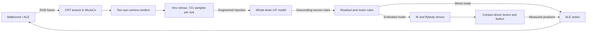

# NO-FLY-ZONE — architecture and reproduction notes

Current implementation, reviewed 2026-09-22. The original design evolved
substantially: the default is FlyWire, CUDA exists, idle scanning is optional,
physical controls work, and learning has been tested. For that chronology,
read [JOURNEY.md](../JOURNEY.md); for individual changes, [CHANGELOG.md](../CHANGELOG.md).

## The loop

`PilotLoop` owns the loop. The game advances at 15 control ticks per second
(4 emulator frames at 60 Hz); each tick applies the action selected from the
previous percept. GL rendering stays on one thread for macOS compatibility.
The brain never receives the emulator's object coordinates or a target detector.
Game reward and damage are available separately to the learning machinery.

| Component | Responsibility | Main implementation |
|---|---|---|
| Game | ALE registration, actions, RGB frames, reward, life loss and automatic game-over reset | `src/noflyzone/game.py` |
| Cockpit | Scene, textured screen, body attachment, rendering and optional physical controls | `src/noflyzone/cockpit.py` |
| Retina | Hexagonal image sampling, luminance and transient drives | `src/noflyzone/retina.py` |
| Brain engine | Sparse connection matrix, LIF state, delayed spikes and Poisson input | `brain_lif.py`, `brain_cuda.py`, `brain_backend.py` |
| Brain interface | Cell annotations, input maps and descending-neuron pools | `src/noflyzone/brain_connectome.py` |
| Controls | Rate calibration, steering, startle, movement gating and action mapping | `dn.py`, `controls.py` |
| Experiment layer | Batched flies, PPO feature readouts and three-factor plasticity | `rl_env.py`, `plasticity.py`, scripts |
| Inspection | Dashboard, live window, trace files and provenance | `dashboard.py`, `liveview.py`, `provenance.py` |

## Eyes and neural input

The retina is a project-local hex sampler; it does not import flygym's
retina. Eye cameras are fixed in the cockpit near head height. The sampler
uses image-plane windows, not anatomical rays through every ommatidium.
`WHITE_REF=255` was checked on the workstation's NVIDIA render path.

The playing baseline uses injection `v4`, zoom 2 and eye offset 0.15.
The zoom covers the central portion of the image; opposite offsets give
the two eyes different, overlapping windows on the same screen. Input
rates are Poisson drives into named visual cell populations. The medulla
channels bypass limitations of the earliest visual pathway in this model.

| Map | Purpose | Interpretation |
|---|---|---|
| `v0` | Early photoreceptor and medulla injection | Retained as script default/reference configuration |
| `v4` | Expanded ON/OFF and small-object-relay inputs | Baseline for the documented reflex pilot |
| `v5` | Additional slow Mi4/Mi9 channels | Did not establish T4/T5 direction selectivity |
| `v6`, `v6m` | Retinal motion correlator injected at T4/T5, optionally mirroring the right eye | Direction is engineered at the input; downstream routing is tested |
| `v7` | Retinal centre-surround processing | Insufficient for small-versus-loom selectivity |
| `v8` | Surround plus wide-field suppression across channels | Also creates selectivity in shuffles and suppresses looming |
| `v9` | Small-object channel restricted to T2/T2a/T3 | Measured wiring selectively routes this supplied signal |

These are alternative experimental configurations, not a single cumulative
biological reconstruction. `FlySquad` uses the baseline input path; do not
assume it implements every newer map available in the standalone pilot.

## Datasets and model

FlyWire v783 is loaded from the connectivity distributed with the Shiu
reference implementation. There are 138,639 neurons and 15,091,983 input
connection records. Each record represents a directed connection weighted
by anatomical synapse count. Earlier notes sometimes called the record
count “synapses”; it is not the number of individual anatomical synapses.

MaleCNS v1.0 is converted into the same index, connectivity and annotation
formats by `scripts/build_malecns.py`: 166,700 retained neurons and
25,582,938 directed pairs. The loader verifies the three source files
against pinned SHA-256 hashes and records conversion decisions in a manifest.
It includes VNC data, but the physical controller does not use a neural VNC.

Both engines implement the Shiu-derived point-neuron LIF dynamics with
0.1 ms steps, a 20 ms membrane time constant, 5 ms synaptic time constant,
1.8 ms delay and 0.275 mV per anatomical synapse. Transmitter labels supply
signs; anatomical counts supply the baseline magnitudes. This does not
recover all physiological properties of the measured animal.

Two playing-mode corrections are explicit options:

- `--aminergic zero`: aminergic connections have no fast synaptic weight.
  This prevents the persistent olfactory-region state observed in the
  uncorrected sign convention. Literature transmitter labels are used for
  identifying these cells.
- `--sensory external_only`: incoming recurrent connections to primary
  sensory neurons carry zero weight; those neurons receive injected input.

The reference settings remain the loader default so the reference gates can
still be run. Settings and dataset are stored in brain metadata.

## Readouts and controls

The baseline `pool4` readout uses screened descending types for left/right
steering, DNg100 for drive and a pool for looming/startle. Coincident steer
pool activity supplies its fire signal. The older `v0` mapping reads oviDN
under the legacy `pIP10` contract key in the female, which lacks pIP10;
MaleCNS can read pIP10 itself. That old label is not a biological explanation
of the pooled pilot's firing behaviour.

`dn.py` owns Hz-to-drive calibration. `controls.py` supplies lateralisation
index steering, a three-tick movement suppression period and a 15-tick
startle refractory in the playing configuration. These are engineered motor
rules. Idle scanning is off unless `--idle-scan` is supplied.

Fixed `pool4` calibration is provisional but remains the baseline. Adaptive
calibration tracks each pool's decaying running maximum with a 4 Hz floor.
It did not rescue the harmful learned brains and did not improve the
baseline in the recorded calibration comparison.

## CPU and CUDA

`brain_cuda.ShiuBrainCUDA` subclasses the reference and keeps its API. Per
0.1 ms step it launches four things on the current stream: zero the ring slot
about to be written; a per-neuron Triton kernel (decay for live neurons,
strict threshold, reset of v and g, refractory bookkeeping with the
activated-neuron exemption, Philox Poisson kick, per-neuron count, append to
the delay ring through an atomic counter); a delivery kernel with one program
per recorded spike that atomic-adds the spike's outgoing CSC column into g
exactly DELAY_STEPS later; and a step-counter increment. The ring has
DELAY_STEPS + 1 slots so the read and write slots never coincide. A whole game
tick (667 steps) is captured once as a CUDA graph and replayed, so only the
spike counts cross to the host. Randomness is Philox on (seed, step * n +
neuron): stateless, reproducible after reset(), not bit-identical to NumPy's
stream. Delivery ordering differs at the float32 ulp, which the recurrent
network amplifies over hundreds of steps; `scripts/compare_backends.py`
checks exact per-step agreement for 500 steps and 1% aggregate agreement
over 0.3 s. Each ring row holds one entry per neuron, so it cannot overflow.
Triton prints harmless `_POSIX_C_SOURCE` redefinition warnings when
it builds its driver stub against the uv-managed Python headers.

Batched execution shares the connection matrix, with separate neuronal
state and input for each fly. `reset_rows()` resets selected neural states;
`set_edge_weights()` updates shared weights between graph replays.

The equivalence gates establish the tested short-horizon spike matches and
aggregate agreement. They are not a claim of bit-identical trajectories
for arbitrary durations or Poisson generators.

Historical measurements on Ubuntu 26.04, Python 3.12.14, RTX 4090,
192 GB system RAM, headless EGL, 2026-09-14:

| Gate or run | Recorded result |
|---|---|
| CPU feeding / escape gates | MN9 101 Hz; giant fibre 66/64 Hz, matching the Mac run |
| CUDA feeding / escape gates | MN9 about 102 Hz; giant fibre 66–70 Hz |
| CPU pilot, 90 ticks | Brain 492 ms per tick; about 7.7× slower than real time |
| CUDA pilot, 450 ticks | 5.8 s wall time for 30 s game time; brain 8.9 ms per tick |
| Isolated brain tick | 263 ms CPU versus 5.5 ms CUDA |
| Three-fly batch | About 4.2 ms per fly-tick |
| Embodied pilot, September 20 | About real time; physics roughly 36–37 ms per tick |

The early timing runs predate some later rendering and controller features.
Use run-specific wall-clock reports when comparing performance. Videos are
encoded at game speed.

## Embodied mode (M6, 2026-09-20)

`Cockpit(physics=True)`, reached by `run_m3.py --pilot embodied`. What is
physical and what is not, in order of the loop:

1. The descending neurons' rates go through the same controller as in
   wired mode and give an intended steer and throttle.
2. The intent is turned into a target angle for each lever (a full command
   is 0.3 rad) and into T1 leg joint targets by a damped least-squares
   inverse kinematics on the claw site, so the claw follows the knob's arc.
   Those targets go to the flybody's own leg position servos (gain 0.8).
3. MuJoCo steps 667 times at 0.1 ms per game tick with the flybody's option
   block. The thorax is on the seat frame (a tethered fly); the T1 claws
   adhere (the model's adhesion actuators, on); the levers are fly-scale
   bodies (density 1.18, a 0.05 return spring) that collide only with the
   claws. The fly's own body-part collision geoms are off, tarsi and claws
   excepted, because the thorax mesh interpenetrates head and coxae at the
   stance and a welded fly chatters at 1,000 rad/s from it.
4. The lever hinge angles are read, zeroed where the legs' neutral
   command leaves them, normalised by the 0.08 rad a fly's push achieves
   (measured; the hinge travels 0.55), and become `controls.measured`; the
   ALE action is taken from those, not from the intent, through a dead
   zone of 0.35 of the push range, because a pushed lever rests 0.15-0.26
   from zero when released (a real hysteresis of claw, adhesion and
   servo; the return spring does not change it) and without the dead zone
   that rest sat on the reverse threshold and the fly backed up for 940 of
   1,500 ticks. The treads on the dashboard show the physical levers.
5. Fire is physical too: the button is a sprung slide placed where the
   fully extended proboscis reaches (1 mm into the tip's path, spring
   8 against a gravity load of 0.005 and a servo of 0.1), colliding only
   with the rostrum, haustellum and labrum geoms; the fire intent
   extends the rostrum and haustellum to their limits and the shot is
   taken when the button reads 0.35 of its travel (rest 0.08, pressed
   0.57). The fly fires by extending its proboscis onto the button. The
   wings, whose joints are torque motors with no command, are held at the
   stance by a weak spring.

Measured: the gate `scripts/validate_embodied.py` moves the levers to
+1.0 forward, -0.7 back, and (+0.9, -0.7) for a turn, with the claws in
contact throughout and no chatter; physics costs about 32 ms per 66.7 ms
game tick on the workstation CPU, so the embodied pilot runs at about
real time with the CUDA brain. A MuJoCo 3.13 quirk found on the way: with
the levers' contact flags written in the XML on every geom of the body,
the claw contacts vanished; set after compile they are kept.

Played: on seed 0, 100 s, with the levers physical and fire still
puppeted, the embodied pilot scored 3000 with seven lives lost and the
same action mix as the wired pilot (NOOP 1,335, DOWN 111, UP 20, FIRE 21
against 1,325 / 108 / 29 / 28); with fire physical too it scores 2000
with three lives lost and 16 fire ticks against the wired pilot's 28,
the proboscis being slower to the button than a puppeted switch. Both at
about real time with physics at 36-37 ms per tick; the levers reach
-0.75 to +1.0 of the push range. Before the proportional loop and the
dead zone the fly held reverse for 940, then 1,399, of 1,500 ticks.

Open: the achieved lever angle is about a quarter of the IK target (servo
gain against spring and contact), which the normalisation absorbs; the
VNC for the male; the fly's hind legs do nothing.

## Reproducing the comparisons

Start with the [README setup and full pilot command](../README.md#run-it).
The `run_m3.py` defaults intentionally retain the early `v0` reference path;
use the complete playing flags for the recorded baseline.

The corrected pilot benchmark varies the start using a seeded burst of
15–60 random actions. It supports whole-brain shuffles, within-hemisphere
shuffles, silencing and gain scaling. See its `--help` and the commands in
[the wiring note](research/wiring-controls-2026-09-18.md).
A bare `--seed` change in `run_m3.py` does not introduce that warm-up.

For the male, obtain the v1.0 flat-connectome files from the
[official download page](https://male-cns.janelia.org/download/), place
these in `data/malecns/`, and run `.venv/bin/python scripts/build_malecns.py`:

- `body-annotations-male-cns-v1.0-minconf-0.5.feather`
- `body-neurotransmitters-male-cns-v1.0.feather`
- `connectome-weights-male-cns-v1.0-minconf-0.5.feather`

The converter checks the version by hash; it is not a downloader. Add
`--dataset malecns --weight-scale 0.6` to supported scripts and use
`--readout pool_male` for the recorded male pilot. The corrected placement
uses annotated hex columns and partner-derived columns for missing cells.
The residual photoreceptor count imbalance remains documented.

## Learning protocol: current limitation

`train_readout.py` trains a PPO action readout on a frozen connectome,
a shuffled connectome or retinal features. `train_plasticity.py` instead
changes selected connections in the spiking model while the fixed reflex
controller plays. Rule-off and size-matched shuffled-edge controls are
available; the initial mushroom-body experiment did not run the shuffled
control after finding negligible activity.

**The September 22 review found that the independent-start fix in
`bench_pilots.py` was not propagated to `rl_env.FlySquad`.** Its seed list
only reaches the Gym reset. Eight requested seed labels produced identical
frame sequences under the same 450 actions in a direct check. The wrapper
also does not forward those seeds to the neural RNG. The logged training
runs have different realised histories, but the labels do not establish
independent neural seeds or held-out game starts.

Furthermore, a fixed tick-budget boundary resets episode bookkeeping without
resetting the game; neural rows reset only on game over. Thus 48 logged
“episodes” are not necessarily 48 independently reset games. Episode-level
standard errors in the historical tables should not be treated as accounting
for all dependence.

The numerical observations are preserved. Claims of generalisation to unseen
games require a corrected protocol and fresh runs. No training code was
changed during the write-up, so historical outputs remain interpretable
against the original implementation. See the
[learning audit](research/learning-2026-09-19.md#evaluation-protocol-audit-2026-09-22).

## Tests, artefacts and remaining limits

There are 32 collected tests at this review. The September 22 command
`MUJOCO_GL=egl PYTEST_DISABLE_PLUGIN_AUTOLOAD=1 .venv/bin/python -m pytest
-m "not data and not cuda"` passed 21, with 11 deselected, including the
physical lever and proboscis-button test. The flybody attachment emitted
its known non-fatal constraint/keyframe-limit warning. Data/GPU gates were
not rerun for this documentation pass; their historical results are above.

New run artefacts use `provenance.py` for commit, dirty state, settings,
package versions and an identity hash. Older artefacts predate that change.
The small [review evidence bundle](research/evidence/) contains final-learning
rows and the seed audit; the complete raw run archive, models, fetched data
and full videos remain in gitignored `out/`, `data/` and `assets/`.

Remaining implementation limits worth carrying into future work:

- The damage lamp is outside the default eye view. The game's own damage
  flash can reach the retina; these are different stimuli.
- The CRT is a flat textured box without a curvature/shader treatment.
- Validation gates test silence and selected response pathways, with limited
  seeds. MaleCNS has no labelled sugar-GRN set for the same feeding gate.
- Wired body attachment may fall back to a bare cockpit if assets are absent.
  The physical validation script explicitly requires the flybody.
- There is no Apple MPS brain backend. macOS uses SciPy; keep GL on the
  main thread. A historical Mac editable-install issue is recorded in Git
  history; it is not a required Linux setup step.
- The project uses private MuJoCo renderer and ALE frameskip attributes.
  Use the tested constraints; broad dependency lower bounds are not a
  guarantee that every older combination works.
- The standalone M3 runner does not yet close the whole loop on every exit
  path. The loop itself has `close()`; cleanup is a future code change.
- The fly is tethered. Its legs use IK, not a learned biological motor
  circuit; hind legs are not used as controls.
